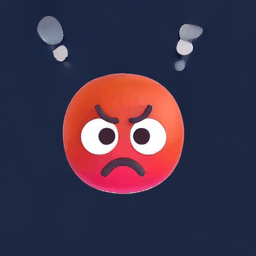
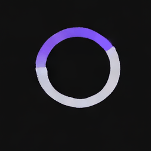
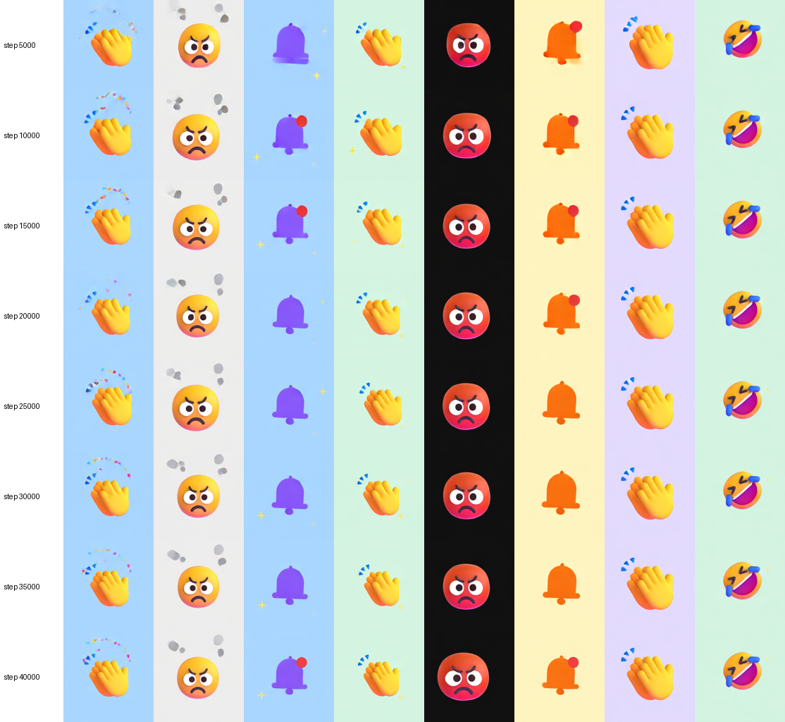

# Bhaav-E

**A 212M-parameter text-to-video model that makes 2-second animated stickers, trained from scratch for about $12 of
GPU time on data our own code generated.**

**Bhaav** (भाव) means feeling, and the **E** stands for **expressions**: a tiny model that animates expressions.

| | | | |
|---|---|---|---|
|  |  |  |  |
| *a crying emoji bouncing, tears falling, light blue background* | *a red furious emoji pulsing, steam puffing from its head, dark navy background* | *a blue success checkmark drawing itself inside a circle, confetti bursting out, white background* | *a party popper emoji pulsing, sparkles twinkling around it, light grey background* |
|  |  |  |  |
| *a cool emoji with sunglasses floating gently, sparkles twinkling around it, peach background* | *a glowing star emoji wobbling side to side, sparkles twinkling around it, dark navy background* | *a purple loading spinner spinning round and round, pulsing, black background* | *a screaming in shock emoji wobbling side to side, peach background* |

These are the released model (r2), seed 0, 50 steps, guidance 3. They were not picked from several tries; these are
the first and only samples for these prompts.

- **Weights:** [huggingface.co/Mohit5899/bhaav-e](https://huggingface.co/Mohit5899/bhaav-e) (safetensors, EMA)
- **Output:** 256 × 256, 17 frames at 8 fps (2 s), loops
- **Code:** everything in this repo is ours: data generator, model, training, evaluation

---

## The idea in one minute

Think of a flip-book artist who is shown a messy scribble and told "this was a crying emoji bouncing". After seeing
tens of thousands of such pairs, the artist learns to turn *any* scribble into a clean flip-book that matches the
words. Generation is then: start from pure noise and let the artist clean it up in 50 small steps, each nudged by the
caption.

Two shortcuts make this cheap. First, the artist never works on full pixels. A borrowed, frozen **video compressor**
(the Wan2.2 VAE) squeezes each 2-second clip from 3.3M numbers to 61K, and the artist works on that small version.
Second, the training data is **made by code**, so every caption is exactly true. That also means we can check
automatically whether a generated sticker shows what was asked.

## Architecture

```
 caption ──► Flan-T5-Base encoder (FROZEN, borrowed) ──► 35 × 768 word vectors ─┐
                                                                                │ cross-attention
 noise [48 × 5 × 16 × 16] ──► VideoDiT, 211.92M params (TRAINED, ours) ◄───────┘
                               16 blocks, width 768, 12 heads, 2×2 patches → 320 tokens
                               predicts the velocity v = noise − clean
                                     │  50 Euler steps, guidance 3, time shift 5
                                     ▼
 clean latent [48 × 5 × 16 × 16] ──► Wan2.2 VAE decoder (FROZEN, borrowed) ──► 17 × 256 × 256 RGB video
```

- **VideoDiT** (`model/videodit.py`): a Diffusion Transformer (Peebles & Xie, 2023) with 16 blocks, width 768, 12 heads.
  The noise level comes in through adaptive LayerNorm, and the caption through cross-attention.
  Frame 1 can optionally be given clean, so the same model can also animate a still image (trained 25% of the time).
- **Objective:** rectified flow. `x_t = (1 − t)·x0 + t·ε`; the model predicts `v = ε − x0`; mean squared error loss.

## Data: 75,001 stickers from code

`generator/bhaav_gen.py` renders every clip from a recipe and writes the caption from the same recipe.

| | |
|---|---|
| Subjects | 30: 10 emotion faces, 10 animated emoji (fire, rocket, trophy...), 10 UI animations drawn in code (spinner, like, bell...) |
| Motions | 9: bounce, wobble, pulse, float, shake, still, spin, heartbeat, flicker |
| Effects | 12: tears, tears of joy, hearts, sparkles, sweat, steam, zzz, thought bubble, confetti, embers, exhaust, none |
| Backgrounds / accents | 12 background colours, 7 UI accent colours |
| Art | [Microsoft Fluent Emoji 3D](https://github.com/microsoft/fluentui-emoji) (MIT), licence in `generator/assets/fluent-emoji/` |
| Splits | train 61,569 · val 3,750 · test_seen 3,750 · **test_unseen 5,918** (combinations that never appear in train) |

The **unseen test set** is the key design choice. Some subject + effect + motion combinations are held out entirely,
so we can measure whether the model *composes* words it has seen separately, or only remembers combinations it has
seen. `data/README.md` has the details.

**r2 data (the release):** the same clips plus 10,815 new ones. Within each subject, every effect now has the same
number of training clips (`generator/make_r2_split.py`). The train size stays the same.

## Training recipe

| | |
|---|---|
| Objective | rectified flow, MSE on velocity, all latent positions |
| Optimiser | Muon (LR 0.02) for the 2-D weight matrices inside the blocks + AdamW (LR 2e-4) for everything else |
| Schedule | 1,000 warmup steps, flat, then linear decay over the last 25% |
| Batch / steps | 64 clips × 40,000 steps ≈ 41.6 passes over the training set |
| Regularisation | caption dropped 10% of the time (enables guidance), EMA 0.9999, gradient clip 1.0 |
| Precision | bf16 autocast, `torch.compile` |
| Hardware / time | 1 × RTX PRO 4500 (32 GB), about 3.6 h per run |
| Cost | ≈ $2.60 per training run. The whole project, including data encoding, 2 runs and 5 evaluations, is ≈ $12.30 |

VAE latents and T5 caption vectors are computed **once** and cached (`gpu/encode_*.py`). Training then never touches
pixels, which is why it is cheap. Full explanation from first principles: [how-training-works.md](how-training-works.md).

## Results

Measured on 256 seen + 256 unseen test prompts. A per-attribute checker reads each generated sticker: subject, motion,
effect, background and accent. We count a **model error** only on clips the checker reads correctly when given the
*real* video, so checker mistakes are not blamed on the model.

| run | data | seen error | unseen error |
|---|---|---|---|
| r1 | natural mix | 2.0% | 5.3% |
| **r2 (release)** | effects balanced per subject | **2.0%** | **3.3%** |

Guidance 3, effect checker v4. The r1-vs-r2 unseen gap is not statistically significant (sign test p = 0.23, one seed
each). Full analysis: [runs/r2/RESULTS.md](runs/r2/RESULTS.md); r1's evaluation history: [runs/r1/eval/RESULTS.md](runs/r1/eval/RESULTS.md).

What we learned:

- **Subject, background, colour and motion carry over to unseen combinations almost perfectly** (0–1% error).
- **The one real failure is adding the effect a subject "usually" has.** For example, the laughing face gets tears of
  joy when none were asked for. Balancing the effects per subject (r2) cut these from 9 clips to 3.
- **Our checker was the biggest source of error.** The first effect checker (CLIP-based) called many small, visible
  sweat drops and sparkles "no effect". A particle-based checker (`model/effect_check.py`) cut seen effect errors from
  15–20 to 3. Several earlier conclusions changed once the checker improved.
- **Guidance 3 beats 5** on unseen combinations for r1. r2 barely cares.



## Use it

Needs a CUDA GPU (tested on a 24 GB L4; peak memory for smaller cards not measured). The first run downloads the Wan2.2 VAE and Flan-T5-Base from Hugging Face.

```bash
git clone https://github.com/Mohit-5899/bhaav-e && cd bhaav-e
pip install torch diffusers transformers sentencepiece safetensors pillow numpy huggingface_hub
hf download Mohit5899/bhaav-e --local-dir weights
cd model && python sample.py --ckpt ../weights/bhaav_tiny.safetensors --cache ../weights \
    --prompt "a crying emoji bouncing, tears falling, light blue background" --out ../samples
```

Prompts work best in the training caption style: *subject, motion, effect, background*. The model only knows the
30 subjects, 12 effects and 12 backgrounds listed above.

**Reproduce the whole thing** (generate data → encode → train → evaluate): `docs/project-log.md` lists each step in
order. `gpu-plan.md` has the exact pod commands and costs, and `gpu/` holds the scripts that ran on the pods.

## Repository layout

```
generator/       our sticker renderer + split builders (bhaav_gen.py, make_splits.py, make_r2_split.py)
data/            splits and the r2 rebalancing plan. The 3 GB of clips is not stored; the seeded generator re-creates it
gpu/             scripts run on the GPU pod: VAE/T5 caching, r2 training, evaluation, release export
model/           videodit.py · train.py · sample.py · evaluate.py · effect_check.py · motion_check.py · muon.py
runs/            logs, snapshot GIFs, evaluation reports and error sheets for r1 and r2
docs/            examples and the step-by-step project log
how-training-works.md   the training process explained from first principles
improvement-plan.md     what we tried to improve and why, ranked
```

## Limitations

- Tiny world: 30 subjects, 256 px, 2 s. It does not generalise to subjects it has never seen.
- One seed per run, about 250 test prompts per split. Differences of 1–2 points are noise.
- The checkers are our own code and are themselves imperfect: about 95–98% right on real clips.
- Image-to-sticker (a given first frame) was trained but is not exposed in `sample.py` yet.

## Credits and licences

- Code and weights in this repo: MIT (see `LICENSE`).
- Frozen parts: [Wan2.2 VAE](https://huggingface.co/Wan-AI/Wan2.2-TI2V-5B-Diffusers) (Apache-2.0) and
  [Flan-T5-Base](https://huggingface.co/google/flan-t5-base) (Apache-2.0).
- Emoji art: [Microsoft Fluent Emoji](https://github.com/microsoft/fluentui-emoji) (MIT).
- Muon optimiser: Keller Jordan et al. DiT: Peebles & Xie, 2023. Rectified flow: Liu et al., 2022.
